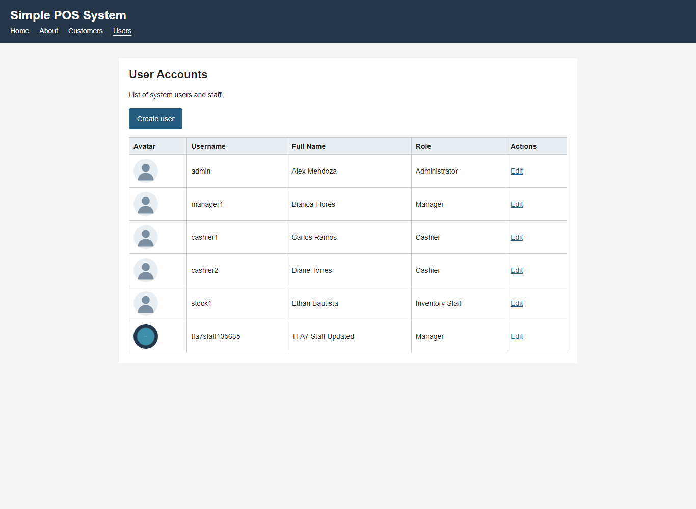

# Simple POS System — Laravel TFA7

Phillip E. Calugay · IT0049 · TC31

TFA7 extends the TFA6 database-backed POS with customer and user creation, validated edit forms, and prepared profile pictures. Home, About, Customers and Users remain available.

Repository: https://github.com/Phillip-Calugay/TFA7

Local application: **http://127.0.0.1:8000**. Local hosting only was requested for this submission. This address works on the machine running PHP; it is not a public hosted URL.

## Setup and run

Requirements: PHP 8.2+, Composer, PDO SQLite, Fileinfo, Mbstring, Exif and GD. Laravel 12 and Intervention Image 3 are pinned in `composer.lock`. No Node.js build is needed; CSS is in `public/css/pos.css`.

For XAMPP, enable `extension=gd` in the active `php.ini` (check `php --ini`) if it is disabled. The included `start-local.bat` loads GD for its own server process. PHP's `upload_max_filesize` and `post_max_size` should exceed 2 MB; the batch file sets them to 4 MB and 8 MB so Laravel can show its 2 MB validation message.

From a fresh checkout in Windows Command Prompt:

```bat
cd /d C:\xampp\htdocs\TFA7
composer install
copy .env.example .env
php artisan key:generate
php -r "file_exists('database/database.sqlite') || touch('database/database.sqlite');"
php artisan migrate --seed
php artisan storage:link
start-local.bat
```

Open http://127.0.0.1:8000. Keep the terminal open; Ctrl+C stops the server. If port 8000 is already in use by this project, open that address directly. PHP must be on PATH; XAMPP's PHP executable is `C:\xampp\php\php.exe`.

For this existing working copy, the database is already migrated and seeded. Run only `start-local.bat`; do not overwrite `.env` or reset the database. Uploaded pictures go to `storage/app/public/avatars`, and `public/storage` links to that public disk. On Windows, creating the link may require an elevated terminal or Developer Mode.

If GD is not enabled globally, install dependencies using:

```bat
php -d extension=gd C:\ProgramData\ComposerSetup\bin\composer.phar install
```

With GD enabled globally, `php artisan serve` also works. For XAMPP Apache, http://localhost/TFA7/ is supported by the root `.htaccess`; enable GD in Apache's PHP configuration and restart Apache after changing it. Set `APP_URL=http://localhost/TFA7` in `.env` and run `php artisan config:clear` when using that address so public disk avatar URLs match it.

## Numbered assignment tasks and screenshots

All images are real browser captures of the local application. The [complete screenshot walkthrough](docs/SCREENSHOTS.md) contains 14 images covering all five tasks and a mobile view. [Capture metadata](docs/screenshots/manifest.json) records each route and result.

| Task | Implementation | Evidence |
| --- | --- | --- |
| 1. Create Customer | `/customers/create`; required full name, valid required email, unique email matching the existing database constraint, optional phone. Errors and `old()` values on failure. | [Validation](docs/screenshots/task-1-customer-validation.png), [created record](docs/screenshots/task-1-customer-created.png) |
| 2. Create User | `/users/create`; required unique username and full name, validated role selection. | [Validation](docs/screenshots/task-2-user-validation.png), [created record](docs/screenshots/task-2-user-created.png) |
| 3. Edit both account types | `/customers/{customer}/edit` and `/users/{user}/edit`; pre-filled fields and PUT updates. Unchanged unique values remain valid. | [Customer form](docs/screenshots/task-3-customer-edit-prefilled.png), [customer saved](docs/screenshots/task-3-customer-updated.png), [user form](docs/screenshots/task-3-user-edit-prefilled.png), [user saved](docs/screenshots/task-3-user-updated.png) |
| 4. Upload and prepare avatar | Nullable `users.avatar` migration; multipart user edit form; image/type validation; maximum 2048 KB and 6000×6000 pixels; Intervention Image GD crop to 256×256 JPEG; UUID filename; `Storage::disk('public')->put()`; only relative path saved. | [Invalid file](docs/screenshots/task-4-invalid-image-rejected.png), [size limit](docs/screenshots/task-4-oversized-image-rejected.png), [file selected](docs/screenshots/task-4-avatar-selected.png), [prepared avatar](docs/screenshots/task-4-avatar-prepared.png) |
| 5. Display avatars | `/users` displays prepared pictures and a local SVG placeholder for records without avatars. | [Avatars and placeholders](docs/screenshots/task-5-user-avatars-and-placeholders.png) |



Existing avatars are retained when no new file is supplied. Invalid uploads do not update other account fields. A successful replacement removes the previous file after the database update; a failed database save removes the new file. CSRF tokens, model binding, uniqueness checks ignoring only the bound record, field limits, escaped Blade output and accessible error messages are included. File inputs must be selected again after validation errors because browsers do not retain them.

Intervention Image is the image package selected for this implementation; the assignment does not identify a specific instructor-approved package. Its dependency is locked for reproducible installation.

## Project organization and database submission

| Area | Files |
| --- | --- |
| Controllers | `app/Http/Controllers/CustomerController.php`, `UserController.php` |
| Eloquent models | `app/Models/Customer.php`, `User.php` |
| Image preparation and storage | `app/Services/AvatarStorage.php` |
| Account views | `resources/views/customers/`, `resources/views/users/` |
| Shared layout and errors | `resources/views/layouts/app.blade.php`, `resources/views/partials/form-errors.blade.php` |
| Avatar migration | `database/migrations/2026_11_14_000000_add_avatar_to_users_table.php` |
| Routes | `routes/web.php` |
| Repeatable seed data | `database/seeders/PosAccountSeeder.php`, `DatabaseSeeder.php` |
| Tests | `tests/Feature/AccountFormsTest.php`, `PosPagesTest.php`, `PosAccountSeederTest.php` |

All migrations and seeders are included as the database submission artifacts. A fresh seed creates five customers and five staff accounts. The screenshot walkthrough creates another customer and staff account through the forms. Local SQLite data, uploaded files, `.env`, `vendor/`, and browser tooling are excluded from Git.

## Verification

```bat
php -d extension=gd vendor/phpunit/phpunit/phpunit
php artisan route:list --except-vendor
php artisan view:cache
php artisan view:clear
```

Verified: **16 tests, 178 assertions**. Tests use an isolated in-memory SQLite database and fake public disk. They cover required fields, invalid email, old input, uniqueness conflicts, unchanged unique values on edit, missing records, thumbnail dimensions and format, avatar URLs, placeholders, replacement, retained avatars, invalid/oversized uploads without partial updates, existing pages, repeatable seed data and migration rollback/reapply.

Browser verification submits the actual forms with CSRF protection, checks success messages and saved rows, rejects invalid and oversized uploads, verifies the served thumbnail is 256×256, checks every avatar loads, and checks the mobile edit form for horizontal overflow. See `scripts/capture_screenshots.py`; it needs Python, Playwright and Microsoft Edge. Generate its sample image with `php -d extension=gd scripts/create-demo-avatar.php`. The non-personal 900×600 PNG is included in `docs/fixtures/`.

## References

- [Laravel validation](https://laravel.com/docs/12.x/validation)
- [Laravel file storage](https://laravel.com/docs/12.x/filesystem)
- [Intervention Image installation](https://image.intervention.io/v3/getting-started/installation)
- [Intervention Image resizing](https://image.intervention.io/v3/modifying-images/resizing)
