# TFA7 numbered task outputs

These screenshots show real browser form submissions at http://127.0.0.1:8000. The [source image](fixtures/demo-avatar.png) is a 900×600 PNG; its prepared result was verified as a 256×256 JPEG.

## 1. Create Customer

Invalid email produces a field error and preserves the entered name and phone.

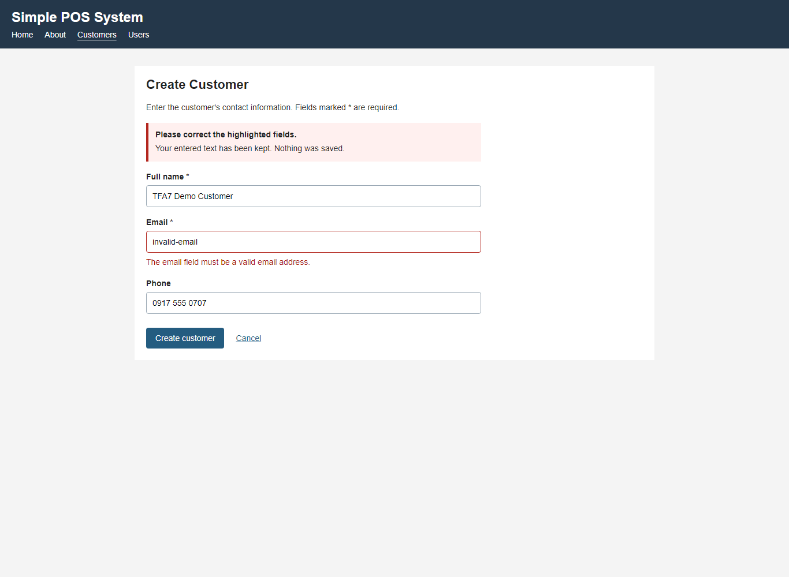

Correcting the email inserts the customer and redirects to the listing with confirmation.

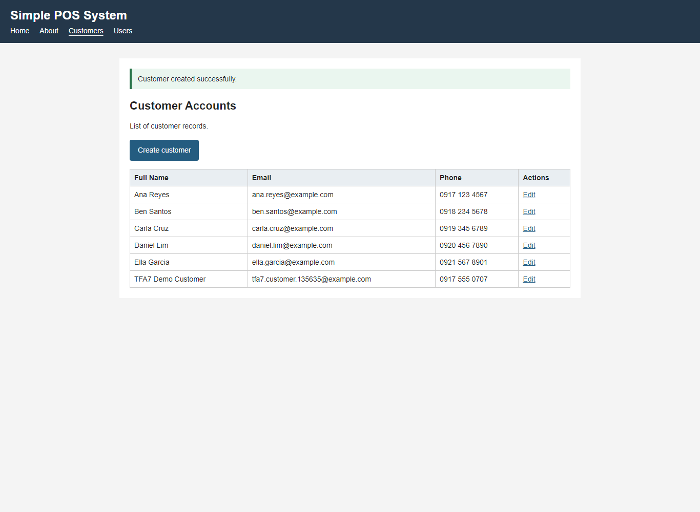

## 2. Create User

A duplicate username and blank full name are rejected.

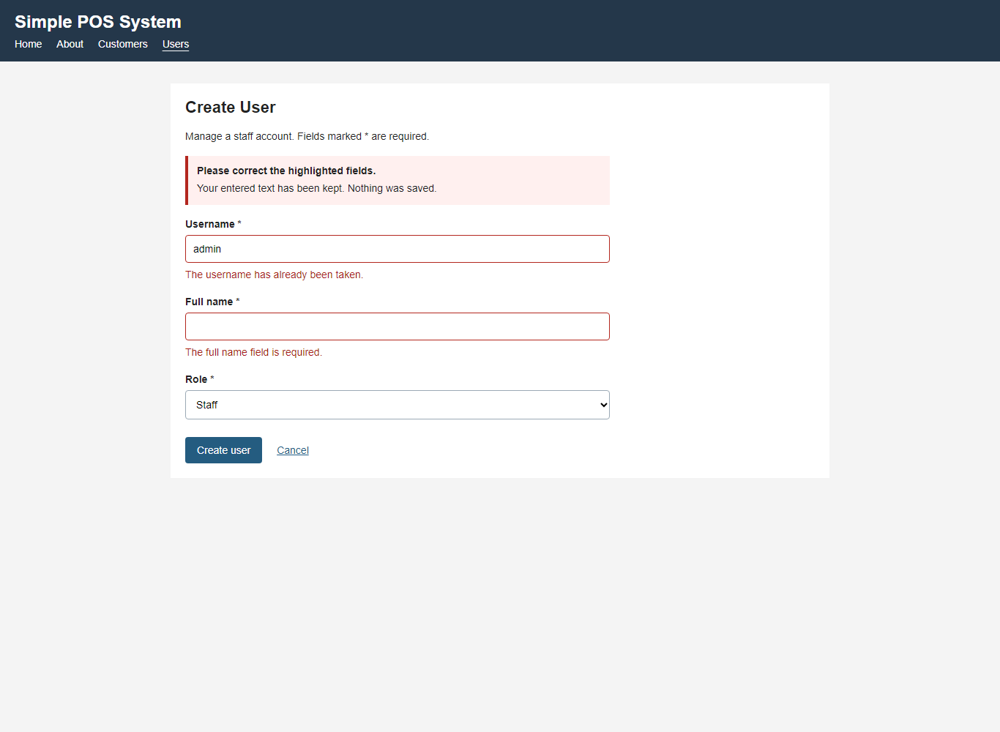

A unique username and valid details create a staff record.

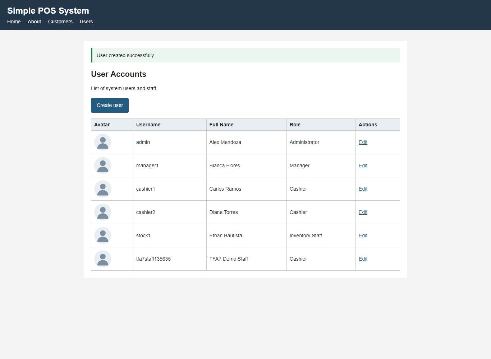

## 3. Edit Customer and User

The customer form contains existing database values.

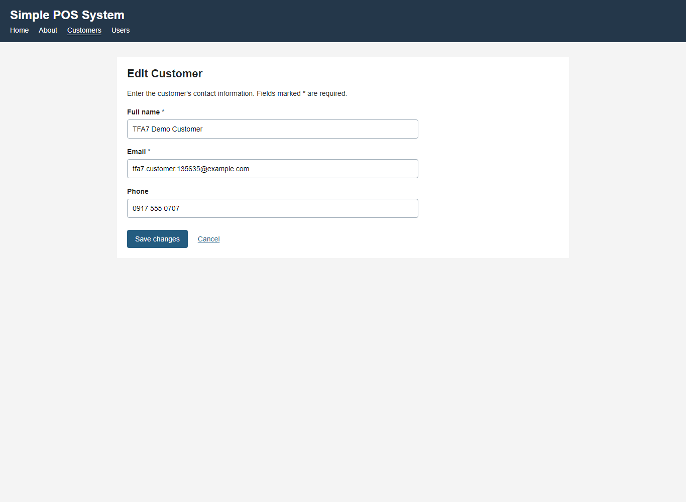

The updated name and phone appear after saving.

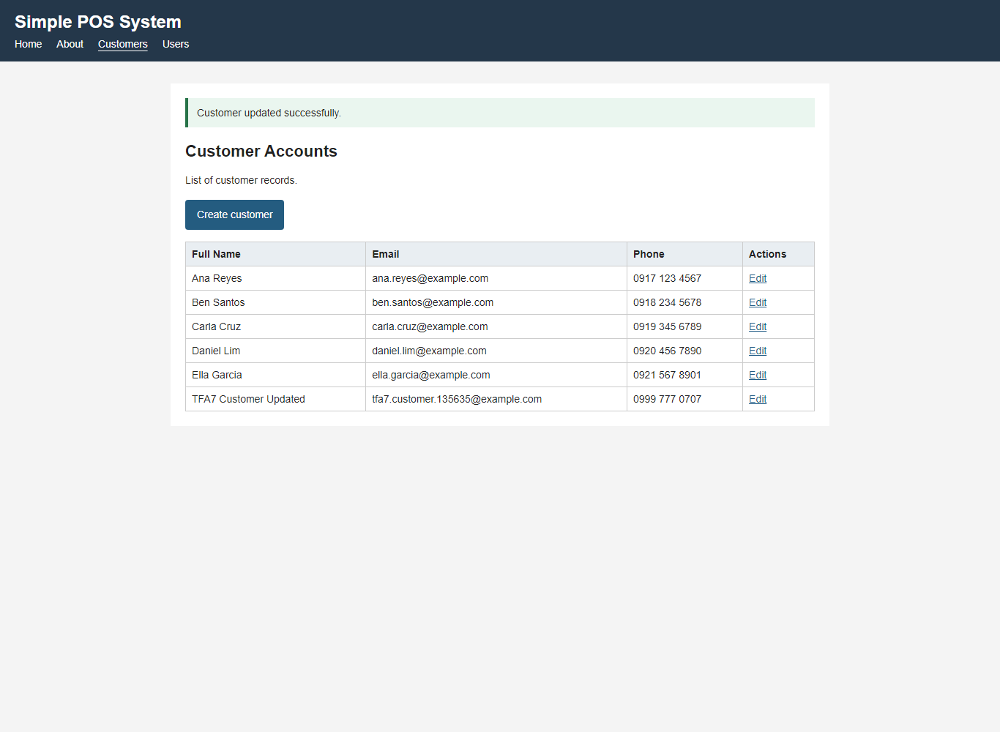

The user form contains the existing username, name and selected role.

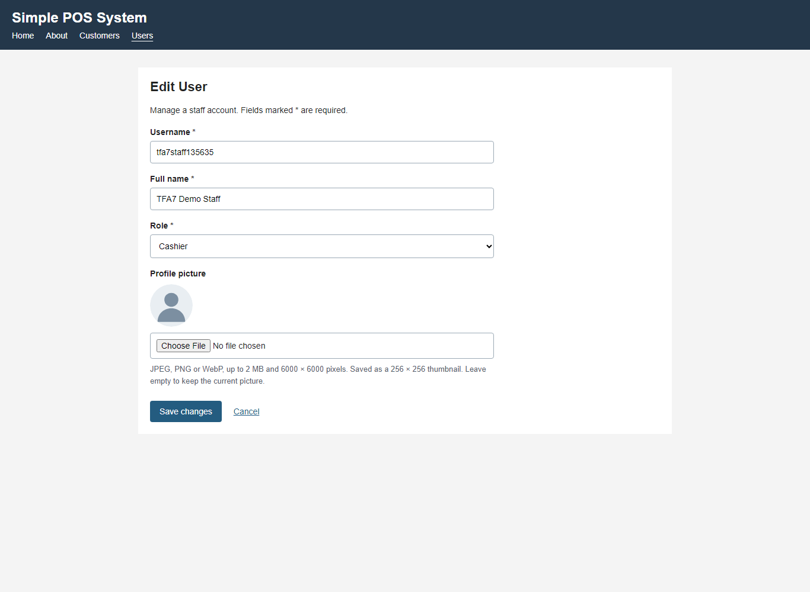

The new name and role appear after saving, retaining the same username.

## 4. Validate, prepare and store an avatar

A text file is rejected as an image upload.

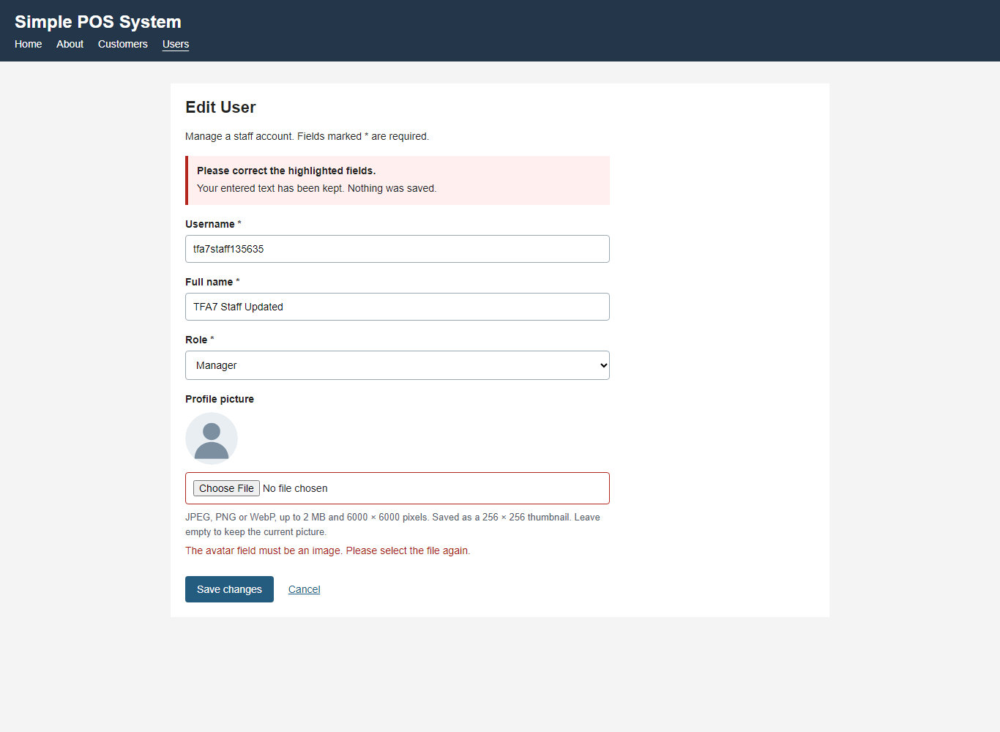

An image larger than 2 MB is rejected without saving account changes.

A valid source image is selected. File selection alone does not save it; Save changes submits the form.

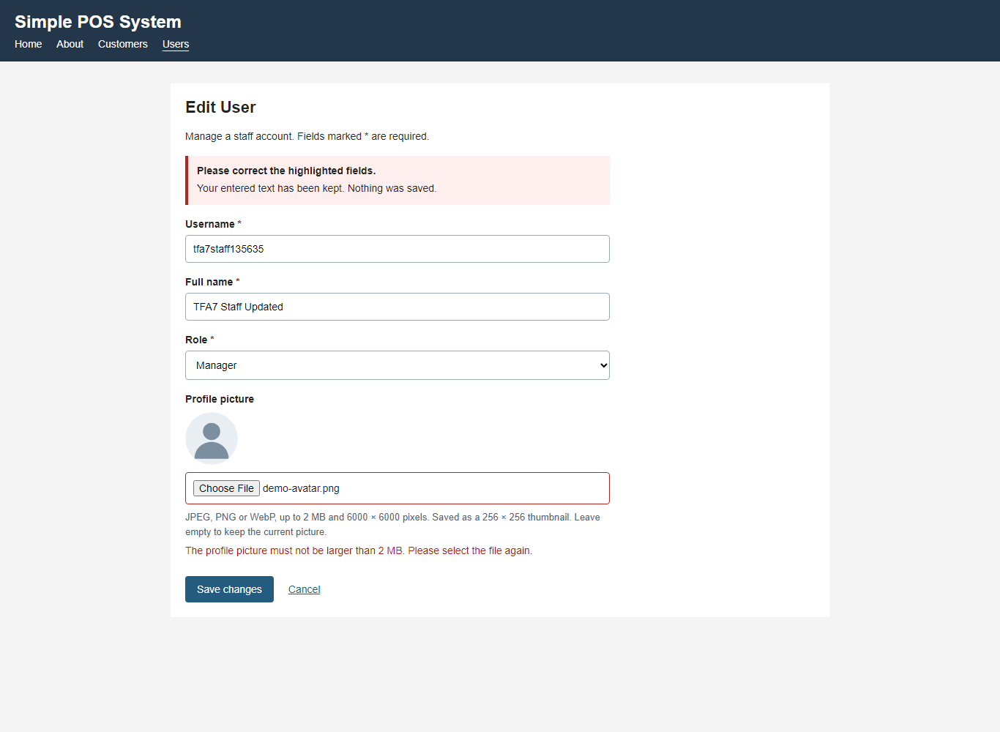

After saving, the edit page loads the prepared thumbnail from the public disk. The browser verified natural dimensions of 256×256; the automated test independently verifies JPEG format and the relative stored path.

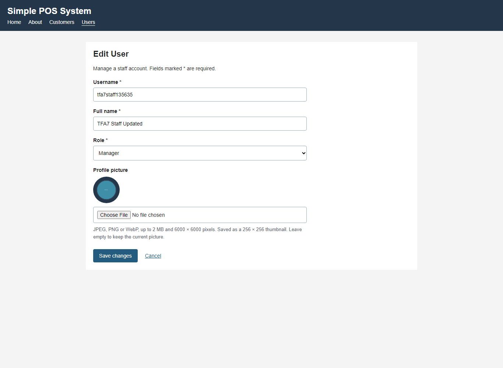

## 5. Display uploaded avatar and fallback images

The last row uses its uploaded thumbnail. Seeded users without an upload show the placeholder. Every image was checked for successful loading.

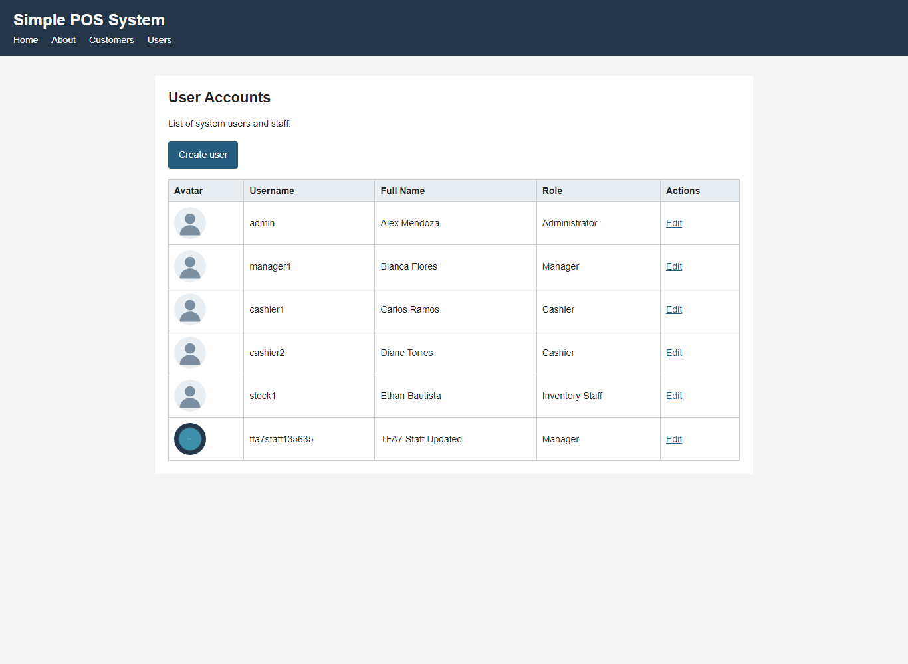

## Additional mobile check

The edit form fits a 390-pixel viewport without page-level horizontal overflow.

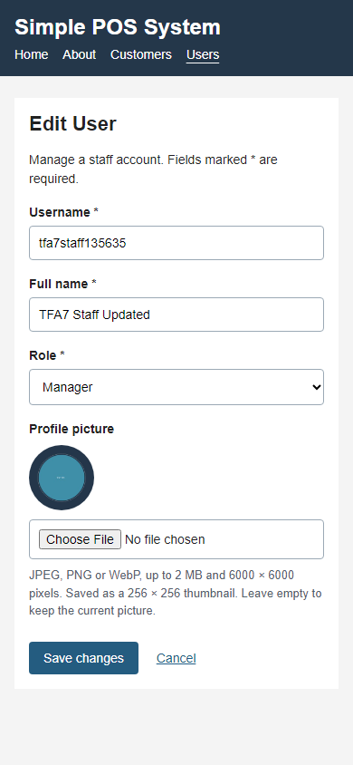
